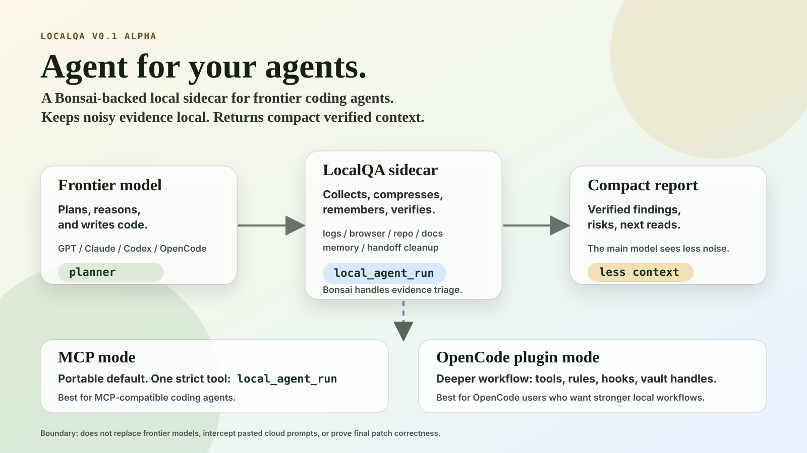
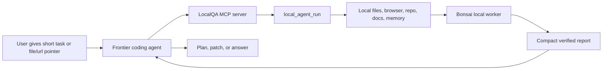
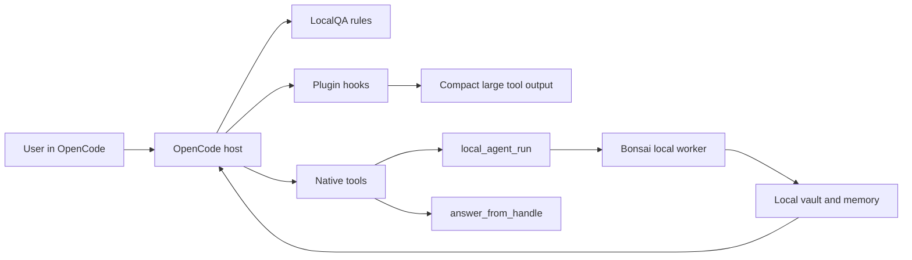
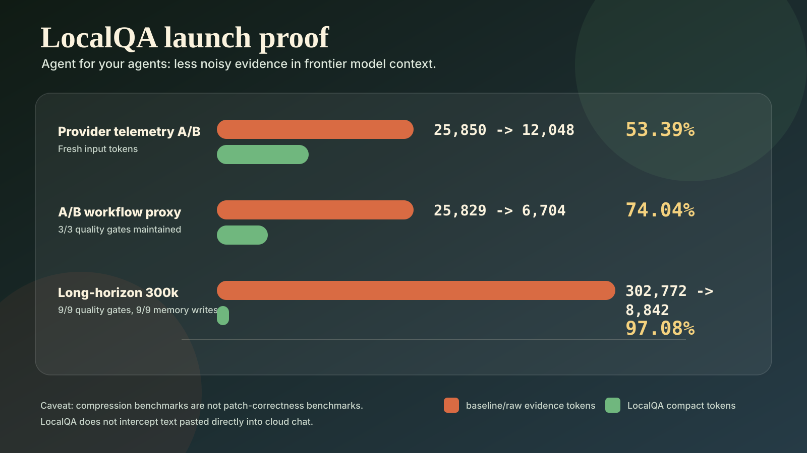

# LocalQA: Agent for your agents



LocalQA is a Bonsai-backed local sidecar for frontier coding agents.

Your main coding agent should plan, reason, and write code. LocalQA handles the noisy local work around it: logs, browser evidence, repo context, docs, previous work memory, redaction, and context cleanup. It returns compact verified evidence so the frontier model spends less context on raw dumps.

```text
Frontier model = planner and implementer
Bonsai = local worker model
LocalQA = sidecar layer for evidence, memory, and handoff cleanup
```

## What we are launching

LocalQA launches with two surfaces:

| Surface | Role | Who should use it first? |
|---|---|---|
| MCP server | Primary public interface | Anyone using an MCP-compatible coding agent |
| OpenCode plugin | Deeper native integration | OpenCode users who want rules, hooks, vault handles, and automatic compaction |

The short version:

```text
LocalQA is MCP-first, with an OpenCode plugin integration.
```

## Why this exists

Coding agents are powerful, but they waste context on low-value evidence work:

| Noisy input | What LocalQA does locally |
|---|---|
| Long logs and stack traces | Dedupes, ranks root-cause lines, returns compact evidence |
| Browser console/network/DOM dumps | Runs local Playwright QA and summarizes verified issues |
| Repo scans and repeated file reads | Compresses codebase evidence into source/test/risk signals |
| Prior work rediscovery | Writes and queries project-local memory |
| Raw handoff payloads | Redacts and prepares compact payloads before cloud reasoning |
| Tool-output bloat | In OpenCode plugin mode, can compact large tool outputs before they stay in context |

## MCP vs OpenCode plugin

| Dimension | MCP mode | OpenCode plugin mode |
|---|---|---|
| Positioning | Portable default | Advanced native workflow |
| Main interface | MCP server over stdio | OpenCode plugin + native tools |
| Primary tool | `local_agent_run` | `local_agent_run` |
| Extra tool | Hidden in strict mode | `answer_from_handle` for local vault queries |
| Host support | Any MCP-compatible agent | OpenCode only |
| Tool surface | One strict public tool | Native tools plus plugin hooks |
| Enforcement strength | Agent chooses to call MCP | Stronger rules/hooks inside the host |
| Large tool-output compaction | Only when routed through LocalQA | Can happen automatically through plugin hook |
| Long-session memory | Returned as tool output | Rules/compaction can preserve vault/memory reminders |
| First-prompt privacy | No | No full first-prompt firewall |
| Best use case | Broad launch and easy adoption | Power users who want deeper local workflows |

MCP says: the main agent can call LocalQA.

OpenCode plugin says: the agent host knows LocalQA exists and can help keep noisy tool output out of context.

## How the MCP flow works



Use MCP when you want the portable one-tool local assistant.

```bash
LOCALQA_PUBLIC_SURFACE=agent-strict npm run localqa:mcp
```

Tell your coding agent:

```text
Use LocalQA as the local evidence and memory layer. Before reading large logs, browser evidence, DOM dumps, screenshots, network traces, or repeated repo context, call local_agent_run. Prefer directed mode for complex work.
```

## How the OpenCode plugin works



Use OpenCode mode when you want deeper integration:

| Feature | What it gives you |
|---|---|
| `.opencode/LOCALQA_RULES.md` | Agent instructions for when to use LocalQA |
| `.opencode/tools/local_agent_run.ts` | Local sidecar agent as a native OpenCode tool |
| `.opencode/tools/answer_from_handle.ts` | Scoped follow-up questions over local evidence handles |
| `.opencode/plugins/localqa.ts` | Hooks for tool-output compaction, env injection, and compaction reminders |
| `opencode.json` | Loads the plugin and LocalQA rules from this repo |

Run OpenCode from this repo root so it discovers `opencode.json`.

## Launch proof



Latest launch check:

```bash
npm run localqa:launch-check
```

| Benchmark | Baseline/raw | LocalQA compact | Saved | Reduction | Quality gate |
|---|---:|---:|---:|---:|---|
| Real OpenCode provider telemetry A/B | `25,850` input tokens | `12,048` input tokens | `13,802` | `53.39%` | One controlled Fastify task |
| A/B workflow proxy | `25,829` tokens | `6,704` tokens | `19,125` | `74.04%` | `3/3` maintained |
| Long-horizon 300k benchmark | `302,772` tokens | `8,842` tokens | `293,930` | `97.08%` | `9/9` quality gates, `9/9` memory writes |

Read these rows with care. The first is one controlled run, not a universal average. The second and
third are scripted comparisons, not provider billing telemetry. They are size ratios of evidence, not
savings measured at a provider, and the 97.08% figure should not be read as a provider saving.

More detailed reports:

- [Benchmarks and claims](./docs/LOCALQA_BENCHMARKS_AND_CLAIMS.md)
- [Provider telemetry A/B](./reports/localqa/provider_telemetry_2026-05-05/OPENCODE_PROVIDER_TELEMETRY_AB.md)
- [A/B workflow benchmark](./reports/localqa/ab_agent_workflows_2026-05-05/AB_AGENT_WORKFLOW_BENCHMARK.md)
- [Long-horizon benchmark](./reports/localqa/long_horizon_300k_2026-05-05/LONG_HORIZON_300K_BENCHMARK.md)

## Quick start

Install dependencies:

```bash
npm install
npx playwright install chromium
```

Run validation:

```bash
npm run localqa:launch-check
```

Start MCP strict mode:

```bash
LOCALQA_PUBLIC_SURFACE=agent-strict npm run localqa:mcp
```

Optional Bonsai autostart environment. The llama.cpp build and the model file this expects are not part of this repository, so it will not start from a fresh clone:

```bash
LOCALQA_DEFAULT_LLM=bonsai \
LOCALQA_BONSAI_AUTOSTART=1 \
LOCALQA_LLM_PROVIDER=openai-compatible \
LOCALQA_LLM_ENDPOINT=http://127.0.0.1:18081/v1/chat/completions \
LOCALQA_LLM_MODEL=Bonsai-8B.gguf \
LOCALQA_PUBLIC_SURFACE=agent-strict \
npm run localqa:mcp
```

## Example tasks

Good prompt:

```text
Use LocalQA to analyze ./logs/dev.log and return only verified auth/session errors. Do not paste raw logs into cloud context.
```

Good directed task shape:

```json
{
  "controlMode": "directed",
  "task": "Investigate login QA failures and return verified evidence only.",
  "directedSteps": [
    {
      "tool": "browser_qa",
      "url": "http://localhost:3000/login",
      "task": "Collect screenshot, console, network, accessibility, and form-state evidence."
    },
    {
      "tool": "log_analysis",
      "filePath": "./logs/dev.log",
      "task": "Find auth, session, csrf, 401, 500, and stack-trace evidence."
    }
  ],
  "outputContract": {
    "maxTokens": 1600,
    "include": ["verified_findings", "evidence", "likely_files", "risks", "next_actions"],
    "exclude": ["raw_dom", "full_logs", "screenshot_metadata"]
  }
}
```

Bad prompt:

```text
Here are 50,000 characters of logs pasted directly into cloud chat...
```

If you paste raw data into cloud chat, it already went to the cloud before MCP can help.

## What LocalQA is not

| Not this | Actual boundary |
|---|---|
| A frontier-model replacement | The frontier model still plans and writes code |
| A guarantee that pasted chat data stays local | Pasted cloud-chat text is already sent to the cloud |
| A patch-correctness proof system | Compression benchmarks are not patch correctness benchmarks |
| A formal DLP/security product | Redaction exists, but this is alpha software |
| Browser QA that works identically everywhere | Local browser permissions vary by machine |

## Public alpha docs

- [Install and usage](./docs/LOCALQA_INSTALL_AND_USAGE.md)
- [MCP vs OpenCode usage](./docs/LOCALQA_OPENCODE_USAGE.md)
- [Benchmarks and claims](./docs/LOCALQA_BENCHMARKS_AND_CLAIMS.md)
- [Security and privacy boundary](./docs/LOCALQA_SECURITY_AND_PRIVACY.md)
- [Launch packet](./LOCALQA_LAUNCH_PACKET_2026-05-06.md)

## License

MIT
