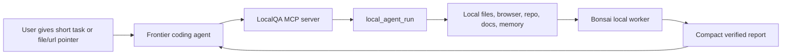
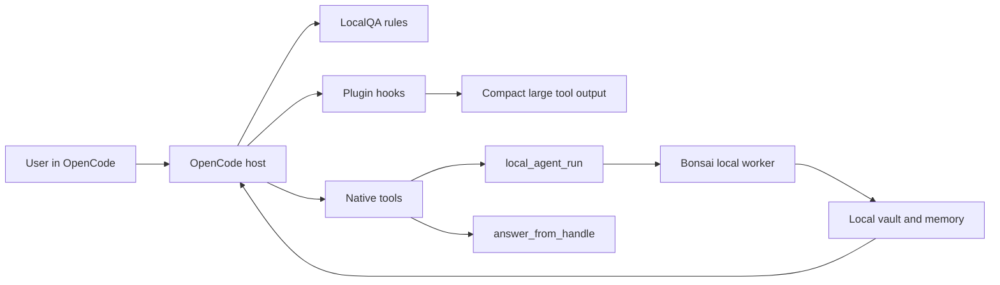

# LocalQA MCP vs OpenCode Plugin

LocalQA is an agent for your agents: a local Bonsai-backed sidecar that handles evidence, memory, cleanup, and handoff work for frontier coding agents.

It launches with two surfaces:

| Surface | Role |
|---|---|
| MCP server | Portable default |
| OpenCode plugin | Deeper native OpenCode workflow |

## Comparison chart

| Dimension | MCP mode | OpenCode plugin mode |
|---|---|---|
| Positioning | Portable default | Advanced native workflow |
| Main interface | MCP server over stdio | OpenCode plugin + native tools |
| Primary tool | `local_agent_run` | `local_agent_run` |
| Extra tool | Hidden in strict mode | `answer_from_handle` for local vault queries |
| Host support | Any MCP-compatible agent | OpenCode only |
| Tool surface | One strict public tool | Native tools plus plugin hooks |
| Enforcement strength | Agent chooses to call MCP | Stronger rules/hooks inside the host |
| Large tool-output compaction | Only when routed through LocalQA | Can happen automatically through plugin hook |
| Long-session memory | Returned as tool output | Rules/compaction can preserve vault/memory reminders |
| First-prompt privacy | No | No full first-prompt firewall |
| Best use case | Broad launch and easy adoption | Power users who want deeper local workflows |

## How MCP works



MCP is the universal connector. It exposes LocalQA as one local worker tool.

Use it when you want a portable integration with MCP-compatible agents.

## How OpenCode plugin works



OpenCode plugin mode adds:

| Feature | What it gives you |
|---|---|
| `.opencode/LOCALQA_RULES.md` | Agent instructions for when to use LocalQA |
| `.opencode/tools/local_agent_run.ts` | Local sidecar agent as a native OpenCode tool |
| `.opencode/tools/answer_from_handle.ts` | Scoped follow-up questions over local evidence handles |
| `.opencode/plugins/localqa.ts` | Hooks for tool-output compaction, env injection, and compaction reminders |
| `opencode.json` | Loads the plugin and LocalQA rules from this repo |

## Important boundary

Neither mode is a network-level prompt firewall.

If a user pastes raw logs or secrets directly into cloud chat, that data has already gone to the cloud before MCP or plugin tooling can help.

Correct pattern:

```text
Use LocalQA to analyze ./logs/dev.log and return only verified auth/session errors.
```

Incorrect pattern:

```text
Here are 50,000 characters of logs pasted directly into cloud chat...
```

## What to say publicly

```text
MCP is the portable default. Use it with any MCP-compatible coding agent.

The OpenCode plugin is the deeper integration. It adds native tools, rules, local vault querying, and automatic compaction hooks inside OpenCode.
```
